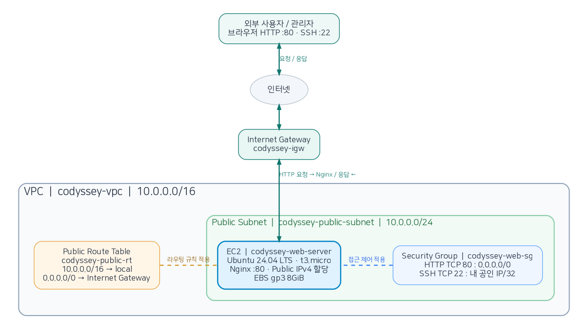
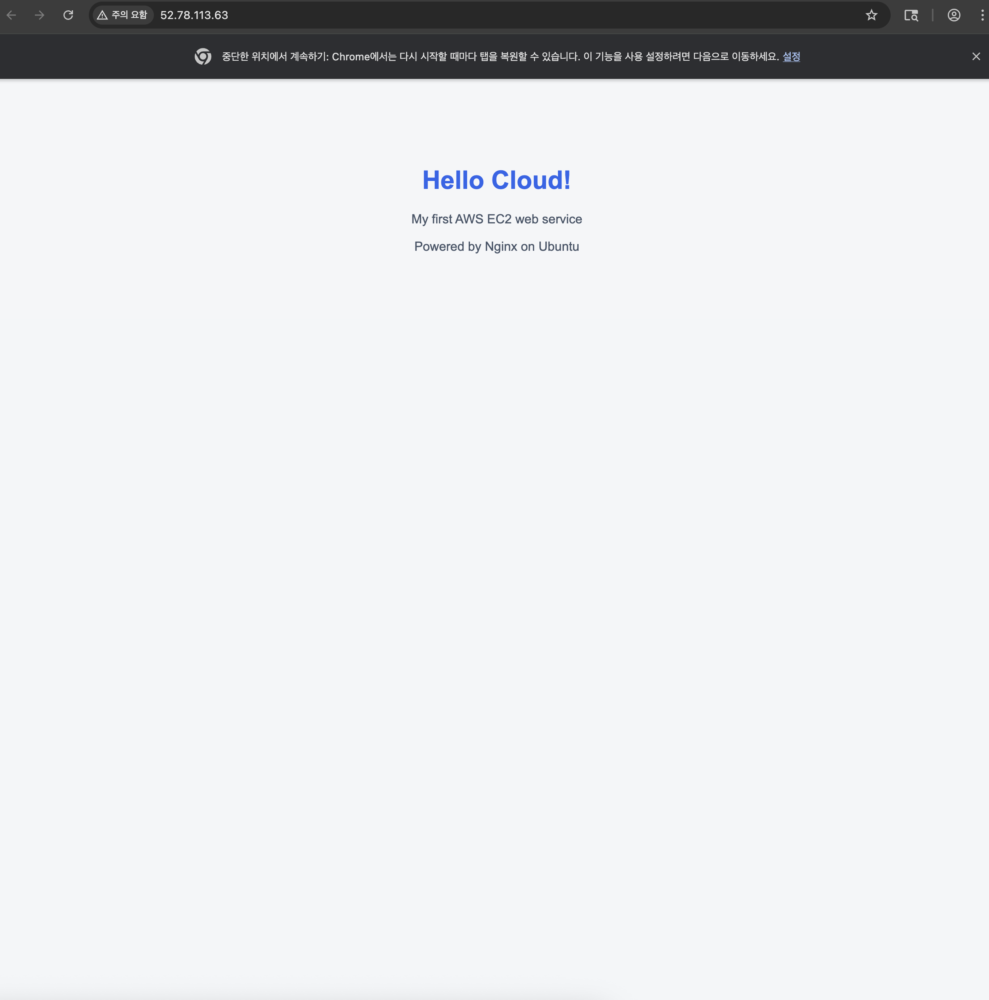
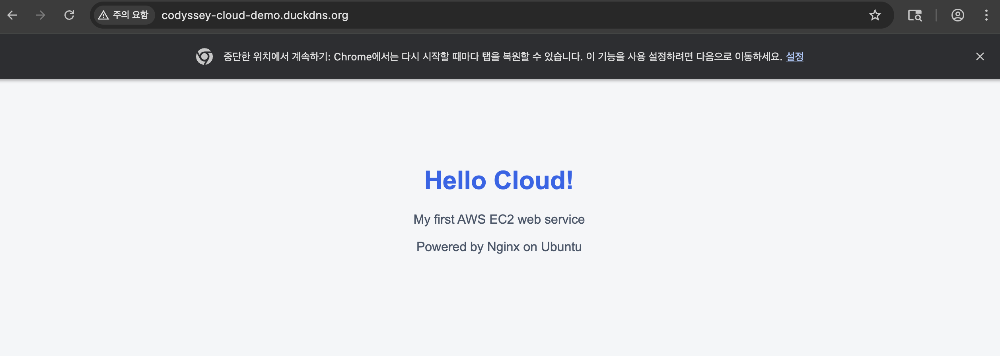
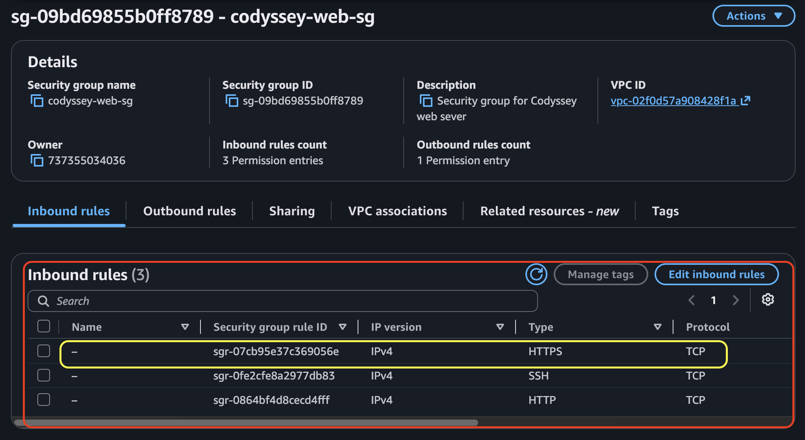
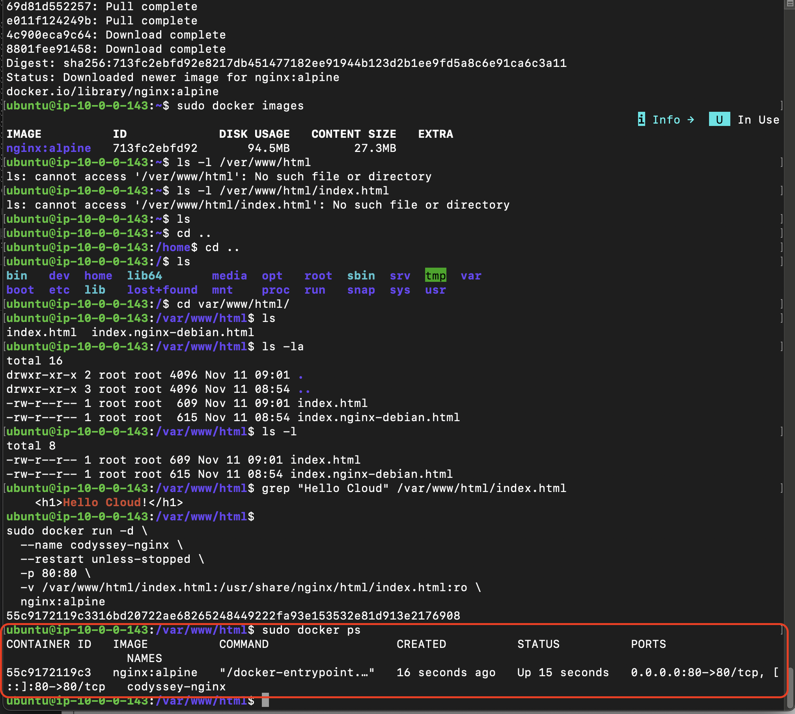
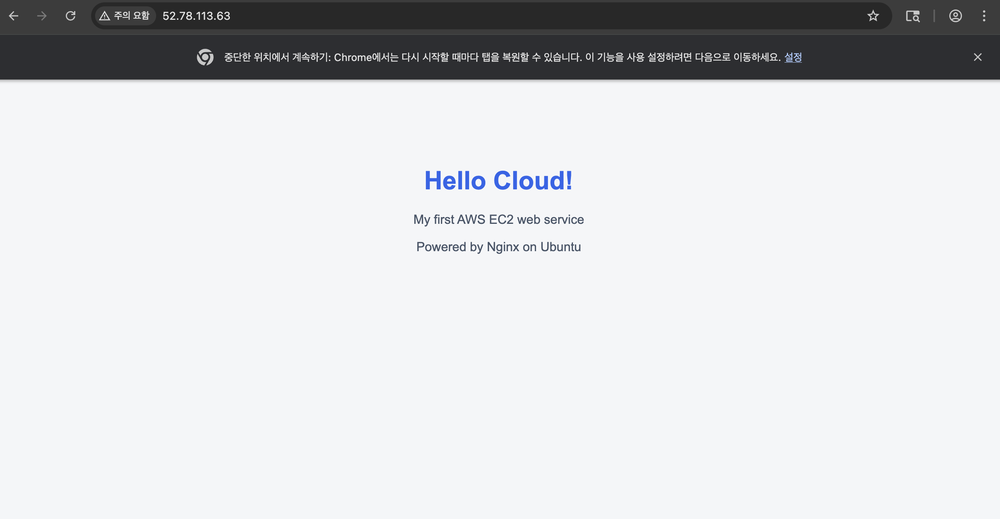
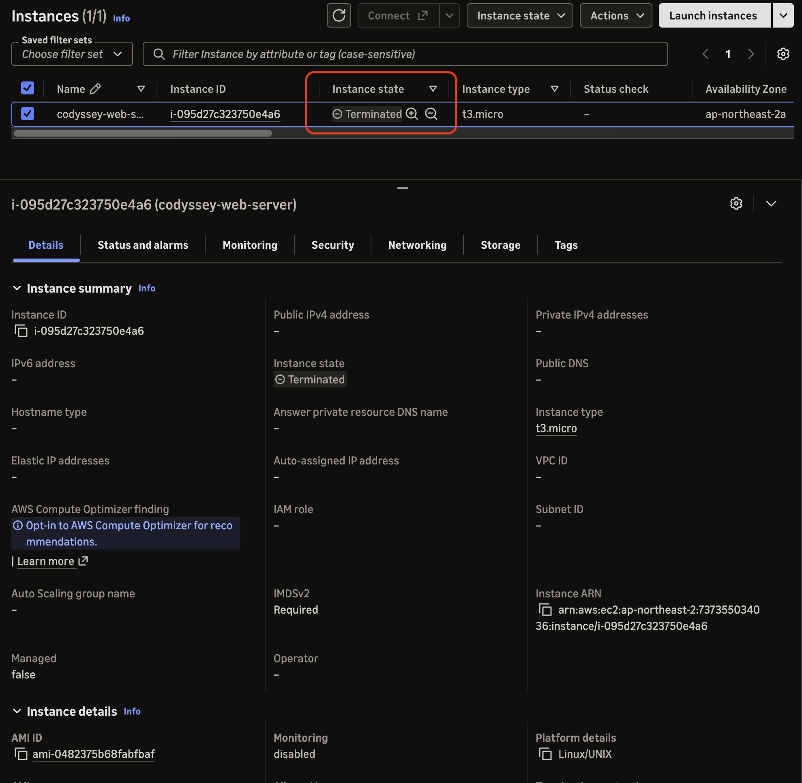
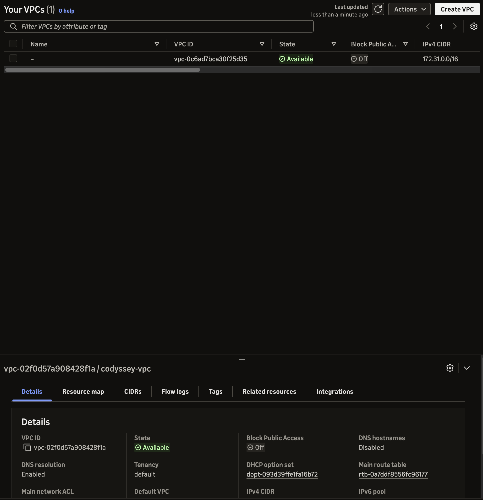

# Codyssey AWS Cloud Deployment

## 아키텍처

AWS 서울 리전(ap-northeast-2)에 VPC와 Public Subnet을 구성하고,
Internet Gateway와 Route Table을 통해 외부 통신 경로를 설정했습니다.

Public Subnet에 EC2 인스턴스를 배치하여 Nginx 웹 서버를 운영합니다.

Security Group은 HTTP 80번 포트를 전체에 허용하고,
SSH 22번 포트는 개인 공인 IP에서만 접근하도록 제한했습니다.



## 1. 프로젝트 개요

AWS VPC와 EC2를 활용하여 외부에서 접근 가능한
Nginx 기반 웹 서비스를 구축한 프로젝트입니다.

## 2. 개발 환경

- Cloud: AWS
- Region: ap-northeast-2 (Seoul)
- OS: Ubuntu Server 24.04 LTS
- Compute: EC2 t3.micro
- Web Server: Nginx
- Storage: EBS gp3 (8 GiB)

## 3. 인프라 구성

- VPC: codyssey-vpc
- Public Subnet: codyssey-public-subnet
- Internet Gateway: codyssey-igw
- Route Table: codyssey-public-rt
- Security Group: codyssey-web-sg
- EC2: codyssey-web-server

## 4. 외부 접속 검증

- 검증 방식: A (브라우저 접속)
- 접속 URL: http://<PUBLIC_IP>
- HTTP 응답: 200 OK
- 웹페이지 출력: Hello Cloud!
- 검증 결과: 성공

### 외부 접속 스크린샷



## 5. 보안 설정

- HTTP (80): 0.0.0.0/0
- SSH (22): 개인 공인 IP/32
- IAM: EC2/VPC 작업 중심의 사용자 지정 정책

## 6. 실행 상태 확인

EC2 내부에서 다음 명령어로 검증했습니다.

```bash
systemctl is-active nginx
curl -I http://localhost
```

검증 결과:
- Nginx: active
- HTTP: 200 OK

## 7. 아키텍처 다이어그램

AWS VPC, Public Subnet, Internet Gateway,
Route Table, Security Group 및 EC2 구성입니다.


## 8. 트러블슈팅

클라우드 환경을 구축하는 과정에서 발생한
문제와 원인 분석, 검증, 해결 과정을 정리했습니다.

[트러블슈팅 보고서](docs/troubleshooting.md)

## 9. 리소스 정리

실습 종료 후 EC2, EBS, 네트워크 리소스 등을
정리하기 위한 체크리스트입니다.

[리소스 정리 체크리스트](docs/cleanup-checklist.md)

현재 상태: 보너스 과제 완료 후 정리 예정

## 10. 보너스 과제

### Docker 컨테이너 배포
- 진행 상태: 예정

### HTTPS 적용
- 진행 상태: 예정


-----


## 보너스 1. HTTPS 적용

### 적용 목적

Let's Encrypt 인증서를 발급하여
Docker 기반 Nginx 웹 서비스에 HTTPS를 적용했습니다.

### 구성 환경

- Domain: <실제 DuckDNS 도메인>
- DNS: DuckDNS
- Certificate Authority: Let's Encrypt
- Certificate Client: Certbot
- Web Server: Docker Nginx
- HTTP Port: 80
- HTTPS Port: 443

### 주요 설정

- HTTP 도메인 요청은 HTTPS로 리다이렉트
- HTTPS는 TLS 1.2 및 TLS 1.3 사용
- localhost HTTP 200 응답 유지
- Certbot 인증서 갱신 절차 설정

### 검증 결과

- HTTPS URL: https://<실제 도메인>
- HTTPS 응답: 200 OK
- HTTP → HTTPS: 301 Redirect
- Docker Container: Up
- 인증서 검증: 성공

### 증빙 자료






## 보너스 2. Docker 컨테이너 웹 서비스 배포

### 1. 적용 목적

기존 EC2에 직접 설치한 Nginx 대신
Docker 컨테이너로 웹 서비스를 배포했습니다.

### 2. 실행 환경

- EC2: Ubuntu 24.04 LTS
- Container image: nginx:alpine
- Container name: codyssey-nginx
- Port mapping: 80:80
- Deployment: Docker CLI

### 3. 실행 방법

기존 Nginx 서비스 중지:

```bash
sudo systemctl stop nginx
sudo systemctl disable nginx
```

Docker 컨테이너 실행:

```bash
sudo docker run -d \
  --name codyssey-nginx \
  --restart unless-stopped \
  -p 80:80 \
  -v /var/www/html/index.html:/usr/share/nginx/html/index.html:ro \
  nginx:alpine
```

### 4. 내부 통신 검증

```bash
sudo docker ps
curl -I http://localhost
```

- Container status: Up
- HTTP response: 200 OK

### 5. 외부 접속 검증

- 접속 방식: 브라우저 HTTP 접속
- URL: http://<PUBLIC_IP>
- 출력 페이지: Hello Cloud!
- 검증 결과: 성공

### 6. 증빙 스크린샷

Docker 실행 상태:



외부 접속 성공:



---

## AWS 리소스 정리

실습 결과를 검증하고 증빙 자료를 확보한 후
AWS 리소스 정리를 수행했습니다.

- 정리 일시: YYYY-MM-DD
- EC2: Terminated 확인
- EBS: 실습용 볼륨 삭제 확인
- Elastic IP: 할당 여부 및 해제 확인
- VPC: 삭제 확인
- Billing: 확인 완료

### 리소스 정리 증빙





### 참고

AWS 리소스가 삭제되었으므로
기존 HTTP 및 HTTPS 서비스는 더 이상 접속할 수 없습니다.

[리소스 정리 체크리스트](docs/cleanup-checklist.md)
